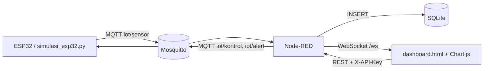

# IoT Dashboard: MQTT + Node-RED + REST API + WebSocket

Dashboard monitoring suhu dan kelembaban real-time dengan kontrol perangkat. Data sensor dikirim lewat **MQTT**, diolah oleh **Node-RED**, disimpan di **SQLite**, lalu ditampilkan di dashboard web lewat **WebSocket** (tanpa polling) dengan grafik **Chart.js**.

## Fitur

- **REST API** untuk data sensor, riwayat, kontrol perangkat, dan batas suhu
- **Autentikasi API key** lewat header `X-API-Key` (REST dan WebSocket)
- **WebSocket** `/ws` untuk update real-time. Dashboard otomatis memakai polling bila koneksi putus, lalu kembali ke WebSocket saat tersambung lagi
- **Grafik real-time** Chart.js (suhu, kelembaban, garis batas atas/bawah)
- **Threshold suhu** lewat `PUT /api/threshold`, tersimpan permanen di database
- **Notifikasi** saat suhu melewati batas: toast di dashboard, notifikasi browser, pesan MQTT `iot/alert`, dan panel debug Node-RED (jeda 30 detik antar notifikasi agar tidak spam)
- **Riwayat di SQLite**, bukan flow context, jadi tidak hilang saat Node-RED restart
- **Simulator ESP32** (Python) yang juga menerima perintah kontrol dan alert

## Arsitektur



## Struktur Proyek

```
.
├── dashboard.html       # Frontend (Chart.js, WebSocket, input API key)
├── flows.json           # Flow Node-RED (import langsung)
├── simulasi_esp32.py    # Simulator sensor ESP32
├── requirements.txt
└── README.md
```

## Prasyarat

- [Node.js](https://nodejs.org/) 18+ dan [Node-RED](https://nodered.org/) 3.x atau 4.x
- [Mosquitto](https://mosquitto.org/) MQTT broker (port 1883)
- Python 3.8+

## Instalasi

### 1. Install node SQLite di Node-RED

```bash
cd ~/.node-red
npm install node-red-node-sqlite
```

Atau lewat menu **Manage palette** di Node-RED, cari `node-red-node-sqlite`. Di Windows, instalasi ini kadang butuh build tools.

### 2. Aktifkan CORS di `settings.js`

Dashboard memanggil API dari origin lain dan memakai header kustom `X-API-Key`, jadi browser mengirim *preflight* `OPTIONS`. Tambahkan di `~/.node-red/settings.js`:

```js
httpNodeCors: {
    origin: "*",    // ganti dengan origin dashboard Anda saat produksi
    methods: "GET,PUT,POST,OPTIONS",
    allowedHeaders: "Content-Type,X-API-Key"
},
```

### 3. Jalankan Node-RED dengan API key

Linux/macOS:

```bash
API_KEY="rahasia-saya-123" node-red
```

Windows (PowerShell):

```powershell
$env:API_KEY="rahasia-saya-123"; node-red
```

> Bila `API_KEY` tidak diatur, flow memakai kunci bawaan `dev-key-ganti-saya`. **Selalu ganti untuk penggunaan nyata.**

### 4. Import flow

1. Buka `http://localhost:1880`
2. Menu ☰ → **Import** → pilih `flows.json` → **Import**
3. Klik dua kali node konfigurasi **Mosquitto** dan sesuaikan host broker bila perlu
4. Klik dua kali node konfigurasi **sqlitedb** dan ubah `Database` menjadi path absolut, misalnya `/home/user/iot_data.db`. Path relatif mengikuti folder tempat Node-RED dijalankan
5. Klik **Deploy**

Tabel `readings` dan `settings` dibuat otomatis saat deploy.

### 5. Jalankan simulator

```bash
pip install -r requirements.txt
python simulasi_esp32.py
```

Gunakan `MQTT_BROKER=alamat-broker` bila broker tidak berjalan di `localhost`.

### 6. Buka dashboard

Buka `dashboard.html` di browser, lalu masukkan API key yang sama. Key disimpan di `localStorage` browser, dan bisa diganti lewat tombol **API Key**.

Bila Node-RED tidak berada di `localhost:1880`, ubah `API_HOST` di bagian atas `<script>` pada `dashboard.html`.

## Referensi API

Semua endpoint memerlukan header `X-API-Key`. Tanpa header yang benar, server membalas `401`.

| Method | Endpoint | Deskripsi |
|--------|----------|-----------|
| GET | `/api/suhu` | Pembacaan sensor terbaru dan status online |
| GET | `/api/history?limit=10` | Riwayat dari SQLite (maks. 500), urut lama ke baru |
| GET | `/api/threshold` | Batas suhu saat ini |
| PUT | `/api/threshold` | Atur batas suhu |
| POST | `/api/kontrol` | Kirim perintah ke perangkat lewat MQTT |

### Contoh

```bash
KEY="rahasia-saya-123"

# Data terbaru
curl -H "X-API-Key: $KEY" http://localhost:1880/api/suhu

# 20 data terakhir
curl -H "X-API-Key: $KEY" "http://localhost:1880/api/history?limit=20"

# Atur batas atas 28.5 °C dan batas bawah 20 °C
curl -X PUT http://localhost:1880/api/threshold \
  -H "Content-Type: application/json" -H "X-API-Key: $KEY" \
  -d '{"max": 28.5, "min": 20}'

# Nonaktifkan batas bawah
curl -X PUT http://localhost:1880/api/threshold \
  -H "Content-Type: application/json" -H "X-API-Key: $KEY" \
  -d '{"min": null}'

# Nyalakan lampu
curl -X POST http://localhost:1880/api/kontrol \
  -H "Content-Type: application/json" -H "X-API-Key: $KEY" \
  -d '{"device": "lamp", "action": "on"}'
```

Aturan validasi `PUT /api/threshold`: `max` dan `min` berupa angka antara -50 dan 150 (atau `null` untuk menonaktifkan), minimal satu field diisi, dan `min` harus lebih kecil dari `max`. Bawaan: `max = 30`, `min = null`.

Contoh respons `GET /api/suhu`:

```json
{
  "status": "success",
  "online": true,
  "data": { "suhu": 29.4, "kelembaban": 67.2, "timestamp": "2026-11-23T10:00:00", "received": "2026-11-23T10:00:00.512Z" }
}
```

## Protokol WebSocket

Endpoint: `ws://localhost:1880/ws`. Browser tidak bisa mengirim header kustom saat membuka WebSocket, jadi autentikasi dilakukan lewat pesan pertama.

**Klien ke server**

```json
{ "type": "auth", "key": "rahasia-saya-123" }
{ "type": "ping" }
```

Kirim `ping` setiap ±20 detik. Klien yang diam lebih dari 60 detik dianggap terputus dan tidak lagi menerima broadcast.

**Server ke klien**

| `type` | Isi `data` | Kapan |
|--------|-----------|-------|
| `auth_ok` / `auth_fail` | - | Balasan autentikasi |
| `sensor` | `{suhu, kelembaban, timestamp, received}` | Setiap data sensor masuk |
| `alert` | `{level, suhu, batas, message, time}` | Suhu melewati batas |
| `threshold` | `{max, min}` | Batas diubah (dari klien mana pun) |
| `control` | `{device, action, timestamp}` | Perintah kontrol dikirim |

Hanya klien yang sudah mengirim `auth` dengan key benar yang menerima broadcast.

## Topik MQTT

| Topik | Arah | Isi |
|-------|------|-----|
| `iot/sensor` | perangkat → broker | `{"suhu": 29.4, "kelembaban": 67.2, "timestamp": "..."}` |
| `iot/kontrol` | Node-RED → perangkat | `{"device": "lamp", "action": "on", "timestamp": "..."}` |
| `iot/alert` | Node-RED → siapa pun | `{"level": "high", "suhu": 31.2, "batas": 30, "message": "...", "time": "..."}` |

## Skema Database

```sql
CREATE TABLE readings (
  id INTEGER PRIMARY KEY AUTOINCREMENT,
  suhu REAL NOT NULL,
  kelembaban REAL NOT NULL,
  device_ts TEXT,           -- timestamp dari perangkat
  received TEXT NOT NULL    -- waktu diterima server (ISO 8601, UTC)
);

CREATE TABLE settings (key TEXT PRIMARY KEY, value TEXT NOT NULL);  -- key 'threshold' berisi JSON
```

Data lama dipangkas otomatis setiap jam dan hanya 10.000 baris terakhir yang disimpan. Ubah angkanya di node **Simpan 10.000 data terakhir**.

## Pengujian Cepat

1. Jalankan simulator. Suhu acak 25 sampai 32 °C, jadi batas bawaan 30 °C akan terlewati sesekali
2. Dashboard menampilkan badge **WebSocket: live**, grafik bergerak, dan toast merah saat suhu melewati batas
3. Turunkan batas lewat kolom **Batas Suhu** atau `curl PUT`. Notifikasi langsung muncul karena jeda notifikasi direset saat batas berubah
4. Matikan Node-RED. Badge berubah menjadi mode polling dan dashboard tersambung lagi otomatis setelah Node-RED hidup
5. Ubah API key di dashboard menjadi salah. Dashboard menampilkan error 401 dan meminta key baru

## Troubleshooting

| Masalah | Penyebab / solusi |
|---------|-------------------|
| Browser menampilkan error CORS | `httpNodeCors` belum diatur atau Node-RED belum di-restart, lihat langkah 2 |
| `401 Unauthorized` | API key di dashboard berbeda dengan `API_KEY` yang dipakai Node-RED |
| `auth_fail` pada WebSocket | Sama seperti di atas. Pastikan env `API_KEY` terbaca oleh proses Node-RED |
| Node `sqlite` merah / tidak dikenal | `node-red-node-sqlite` belum terpasang, lalu restart Node-RED |
| `/api/history` kosong | Belum ada data masuk, atau path database salah. Cek panel debug Node-RED |
| Tidak ada data dari simulator | Cek status node `mqtt in` (harus *connected*) dan host broker |
| Dashboard tanpa grafik | Chart.js dimuat dari CDN jsDelivr, jadi perlu koneksi internet. Atau unduh file-nya dan ubah tag `<script src>` |

## Catatan Keamanan

- API key via header memberi perlindungan dasar saja. Gunakan **HTTPS/WSS** (reverse proxy seperti Nginx atau TLS di Node-RED) agar key tidak terkirim sebagai teks biasa, terutama di luar jaringan lokal
- Ganti `origin: "*"` pada CORS dengan origin dashboard Anda
- Aktifkan autentikasi dan password pada Mosquitto bila broker dapat diakses dari luar
- Jangan commit API key asli atau file `.db` ke repositori

## Pengembangan Lanjutan

- Notifikasi ke Telegram atau email: tambahkan node `node-red-contrib-telegrambot` atau `email` pada output alert di node **Proses sensor + cek batas**
- Migrasi ke InfluxDB untuk data time-series volume besar
- Autentikasi per pengguna (JWT) dan role

## Lisensi

Pilih lisensi untuk repositori Anda (mis. MIT) dan tambahkan file `LICENSE`.
